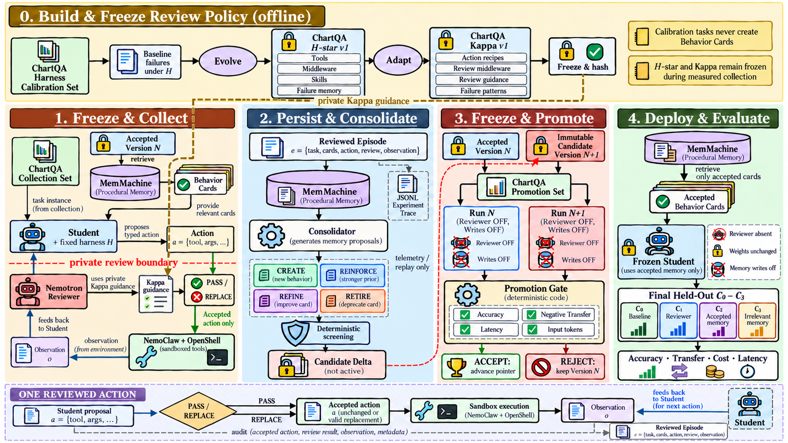
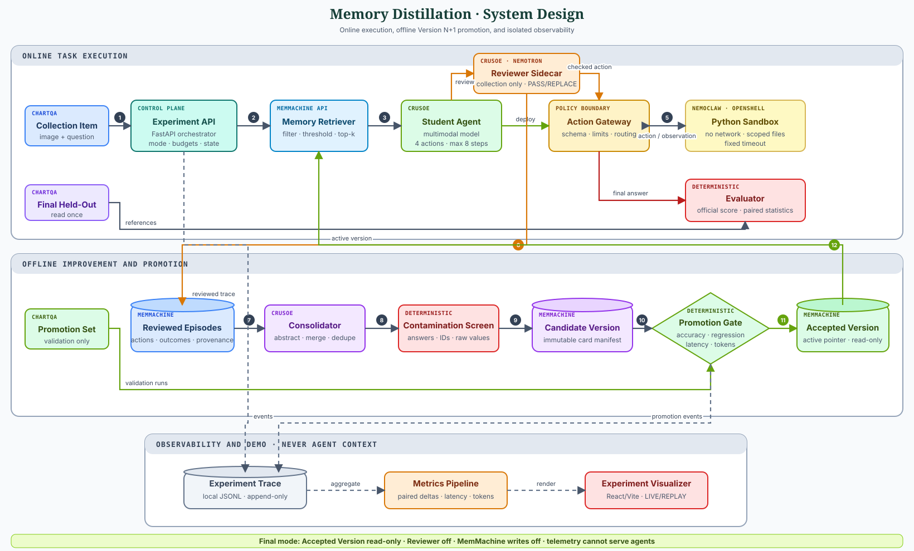

# Memory-Distilled Agent Team

An agent system that turns reviewed ChartQA failures into versioned, answer-free Behavior Cards without updating model weights.

The central claim is **Version N+1**: a fresh Student should improve with a promoted operating procedure from MemMachine while the Reviewer is absent and memory writes are disabled.

## What this project demonstrates

A multimodal Student proposes typed actions. A privileged Reviewer passes each proposal unchanged or replaces it with the smallest valid correction before execution.

Completed reviewed trajectories become Reviewed Episodes. A Consolidator converts repeated evidence into an immutable Candidate Version, which becomes retrievable only after a deterministic promotion gate.

The design makes improvement external, inspectable, reversible, and measurable. A valid negative result remains part of the experiment rather than a reason to retune the held-out evaluation.

## Lifecycle architecture



The lifecycle has five controlled phases:

1. **Calibrate:** derive one bounded H-star proposal and adapt accepted components into frozen Kappa Guidance.
2. **Collect:** review Student actions on the fixed Collection Set and persist eligible Reviewed Episodes.
3. **Consolidate:** produce CREATE, REINFORCE, REFINE, and RETIRE operations over one frozen episode snapshot.
4. **Promote:** compare the Candidate and Accepted Versions on identical Promotion tasks and budgets.
5. **Evaluate:** run the frozen C0–C3 experiment once on the untouched Final Held-Out Set.

Calibration, Collection, Promotion, and Final evaluation use disjoint ChartQA manifests. Candidate memory never becomes active during the lifecycle pass that created it.

## System design



The backend is a modular FastAPI application. Provider-specific behavior stays behind typed inference, sandbox, benchmark, telemetry, and Operational Memory adapters.

The editable architecture source is available at [memory-distillation-system-design.drawio](docs/assets/memory-distillation-system-design.drawio).

### One reviewed action

```text
Student proposal
      │
      ▼
Reviewer + frozen Kappa
  ├── PASS ───────┐
  └── REPLACE ────┤
                  ▼
           Accepted action
                  │
      ┌───────────┼────────────┐
      ▼           ▼            ▼
 image tools   OpenShell    final scorer
      └───────────┼────────────┘
                  ▼
        public observation
                  │
                  ▼
          next Student turn
```

Only the accepted action and its public observation enter the next Student turn. Private Reviewer reasoning remains outside Student context and sanitized replay.

Generated Python runs only through the NemoClaw-managed OpenShell boundary. The adapter applies network, filesystem, process, memory, timeout, and output controls without a local fallback.

## Experiment conditions

| Condition | Reviewer | Memory | Purpose |
|---|---:|---|---|
| **C0** | Off | None | Minimal-harness baseline |
| **C1** | On | None | Online-review ceiling and cost |
| **C2** | Off | Relevant cards from the Accepted Version | Primary memory-distilled condition |
| **C3** | Off | Trigger-irrelevant accepted cards | Extra-context control |

C2 tests whether reviewed behavior transfers through memory without online Reviewer calls. C3 separates useful retrieval from gains caused by receiving additional context.

The report includes paired capability delta, Positive and Negative Transfer, intervention rate, latency, tokens, cost, and the eligible sample size for each comparison.

## Experiment invariants

- The Minimal Harness, models, prompts, tools, budgets, and decoding settings do not change between compared conditions.
- H-star and Kappa use only the 8-item discovery and separate 8-item regression calibration splits.
- Calibration produces no Behavior Cards and no consolidation-eligible Reviewed Episodes.
- The Student retrieves only answer-free cards from one explicitly pinned Accepted or Candidate Version.
- Raw Reviewed Episodes never serve the primary Student condition.
- Candidate Versions are immutable and screened before promotion.
- Accepted-pointer changes require conditional, atomic semantics; non-atomic promotion is rejected.
- The Final Held-Out Set cannot affect prompts, models, thresholds, retrieval, cards, or promotion.
- Local JSONL is telemetry for metrics and replay, never a memory source for an agent.

## Technology stack

| Component | Responsibility |
|---|---|
| [ChartQA](https://github.com/vis-nlp/ChartQA) | Primary multimodal benchmark and official scoring behavior |
| [Crusoe Managed Inference](https://www.crusoe.ai/cloud/managed-inference) | Student, Reviewer, H-star Analysis, and Consolidator inference |
| NVIDIA Nemotron | Privileged multimodal Reviewer |
| [MemMachine](https://github.com/MemMachine/MemMachine) | Managed Reviewed Episodes, immutable versions, Behavior Cards, and accepted state |
| NemoClaw + OpenShell | Policy-controlled execution for Student-generated Python |
| FastAPI + Pydantic | Typed orchestration, APIs, validation, and live event streaming |
| React + Vite | Live and replayable Experiment Visualizer |

## Repository structure

```text
backend/
  experiment_manifests/           # frozen development and final assignments
  src/memory_distillation/
    benchmark/                     # isolated ChartQA access and scoring
    calibration/                   # H-star proposal, regression gate, Kappa freeze
    evaluation/                    # paired C0-C3 execution and reporting
    inference/                     # Crusoe and deterministic adapters
    operational_memory/            # MemMachine and in-memory test adapters
    review_policy/                 # immutable Kappa contracts and screening
    sandbox/                       # OpenShell and deterministic adapters
    task_execution/                # typed Student/Reviewer action loop
    telemetry/                     # append-only events and sanitized replay
    versioning/                    # consolidation, retrieval, and promotion
    visualizer/                    # dashboard evidence contracts
  tests/

frontend/
  src/                             # React Experiment Visualizer

docs/
  adr/                             # accepted architectural decisions
  assets/                          # architecture and lifecycle diagrams
```

## Local development

### Prerequisites

- Python 3.12+
- [uv](https://docs.astral.sh/uv/)
- Node.js and npm
- Docker, NemoClaw, and OpenShell for live sandbox execution
- Provider credentials only for explicit live workflows

### Backend

```bash
cd backend
uv sync
uv run uvicorn memory_distillation.main:app --reload
```

The API is served at `http://127.0.0.1:8000`. Its dashboard endpoints expose validated live artifacts and server-sent `RunEvent` updates.

### Frontend

```bash
cd frontend
npm ci
npm run dev
```

Vite serves the visualizer at `http://127.0.0.1:5173` and proxies `/api` requests to FastAPI.

### ChartQA data

The full dataset is intentionally excluded from Git. Place the official repository at the default development path:

```text
.local/chartqa-source/ChartQA Dataset/
```

The frozen manifests under `backend/experiment_manifests/` bind calibration, Collection, Promotion, and Final tasks by identifier and image hash.

## Configuration

Copy the redacted template and provide only the credentials needed by the workflow being run:

```bash
cp backend/.env.example backend/.env
```

The configuration groups are:

- `CRUSOE_*`: inference endpoint and fixed model roles
- `MEMMACHINE_*`: managed Operational Memory project
- `OPENSHELL_*`: pre-provisioned NemoClaw/OpenShell sandbox

Secrets remain in the ignored `backend/.env`. Dataset files, model weights, raw provider payloads, experiment traces, and generated evaluation artifacts are also excluded from version control.

## Verification

The default backend suite is offline and deterministic:

```bash
cd backend
uv run pytest
uv run ruff check .
uv run mypy
```

Frontend verification uses the pinned npm lockfile:

```bash
cd frontend
npm ci
npm run typecheck
npm run build
```

Live integration contracts are explicit, opt-in commands:

```bash
cd backend
uv run verify-crusoe --confirm-live
uv run verify-memmachine --confirm-live
uv run verify-openshell --confirm-live
```

The checks validate provider schemas and model identities, managed-memory round trips and immutable records, and the OpenShell containment boundary.

## H-star and Kappa calibration

Calibration is shell-driven so the dashboard can remain read-only. The first command prints model identities, sandbox identity, request bounds, token ceiling, estimated price range, and artifact scope.

```bash
cd backend
uv run memory-distillation calibrate
uv run memory-distillation calibrate --confirm-paid-run
```

The paid run exposes only the discovery split while H-star is proposed, then loads the separate regression split. Deterministic evidence decides which rules enter Kappa.

Public progress is written under `.artifacts/calibration/current/` and streamed to the visualizer. Private reasoning, credentials, scoring references, and raw provider payloads are excluded.

The resulting `hstar.json`, `kappa.json`, and `report.json` artifacts are immutable inputs to later Collection and evaluation stages.

## Documentation

- [Revised proposal](docs/PROPOSAL_revised.html)
- [Methodology addendum](docs/PROPOSAL_addendum.md)
- [Canonical terminology](CONTEXT.md)
- [Architectural decisions](docs/adr/)
- [Crusoe capability evidence](docs/verification/2026-10-17-crusoe-capabilities.md)

## Inspiration and extension

This project is inspired by [Harness-Zero: Harness Distillation via Agent-as-Harness](https://arxiv.org/abs/2609.24974v1).

It reuses the response-boundary supervision idea, then changes the transfer mechanism: reviewed behavior becomes inspectable, versioned external memory rather than fine-tuned model parameters.

The runtime excludes Harness-Zero's Harbor, DeepAgents, SFT, benchmark banks, and single-`execute` assumptions. ChartQA uses this repository's typed actions, sandbox boundary, version lifecycle, and C0–C3 evaluation.
