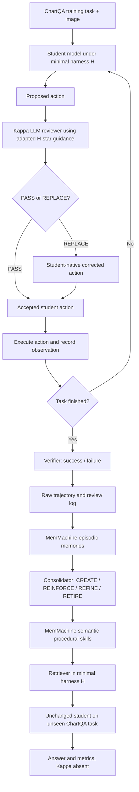
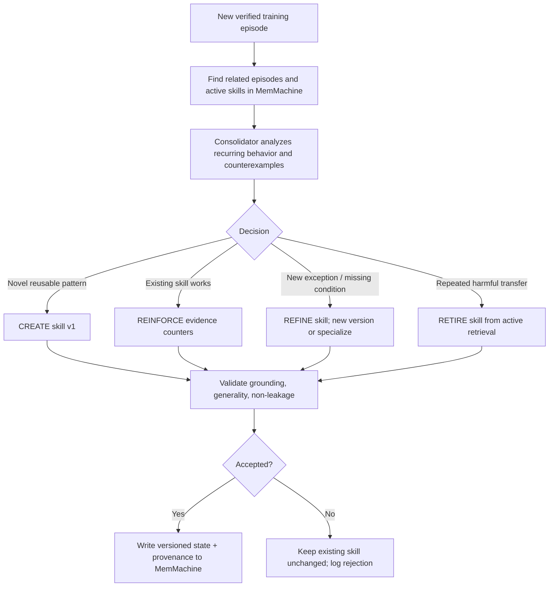
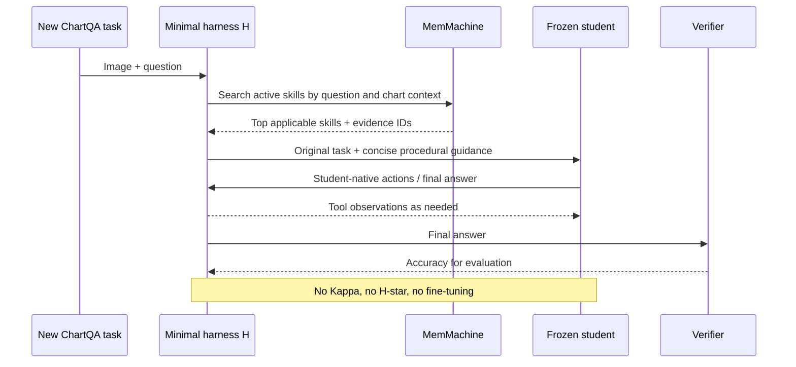
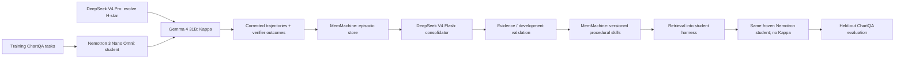

# ChartQA: Harness-Corrected Procedural Memory Distillation

## Purpose

Build a research prototype that transfers behaviors demonstrated by a supervising harness into **external, evolving procedural memory**, rather than into model weights. Use the open-source Harness-Zero workflow for student rollouts, harness evolution, H-star-to-Kappa adaptation, action review, and trajectory logging. Replace its supervised fine-tuning (SFT) stage with MemMachine-backed episodic storage, consolidation, and retrieval.

**Research question:** Can an unchanged, smaller vision-language student improve its accuracy on unseen ChartQA questions by retrieving reusable behaviors distilled from Kappa-corrected trajectories, after Kappa and H-star are removed?

This brief is the intended implementation, not a claim that the proposed MemMachine integrations or benchmarks have already been built or validated.

## Terms and scope

- **H (minimal student harness):** Fixed student prompt, chart image/question input, and student-native actions. Keep it unchanged across comparisons except for the explicitly tested memory-context injection.
- **H-star (optimized harness):** An empirically evolved, more capable ChartQA harness containing reusable tools, workflow skills, middleware, and guards. Obtain it by analyzing failed training trajectories and evaluating improvements, not by assuming the initial proposed rules are optimal.
- **Kappa (adapted reference harness):** The teacher-side reference adapted from H-star to the student's action space. Its LLM reviewer inspects proposed student actions and returns **PASS** or **REPLACE** before execution. Kappa's private review metadata does not enter the student's context.
- **Episode:** A particular task and its student proposal(s), Kappa intervention(s), accepted actions, observations, and task outcome.
- **Procedural skill:** A generalized, conditionally applicable behavior inferred from successful, grounded corrections. It is not an answer to one chart.
- **Consolidator / memory controller:** **One component**, initially driven by DeepSeek V4 Flash, responsible for **CREATE, REINFORCE, REFINE, RETIRE** decisions. No second controller is required.
- **MemMachine:** Persistent episodic/semantic memory and retrieval infrastructure. We own the procedural-skill schema, evidence rules, versioning, and policy for updating/retiring skills. Do not assume MemMachine natively implements those policies or a particular internal graph/vector topology.

## Overall pipeline



**Important timing distinction:** During collection Kappa corrects action proposals in the loop. During evaluation Kappa and H-star are absent. The student gets only its original tools/prompt plus relevant retrieved procedural memory. The student weights never change.

## Phase A: Evolve H-star and adapt Kappa

1. Run the student under **H** on ChartQA **training** questions. Collect proposed actions, observations, final answers, and accuracy.
2. Cluster failures using an analysis/coding agent (initial choice: DeepSeek V4 Pro). Evolve H-star by adding general-purpose checks, skills, middleware, or tools. For example, repeated axis-unit mistakes might justify an axis-label verification step.
3. Evaluate each proposed H-star change on a **separate development subset**; retain changes that improve performance and avoid task-specific answer memorization. A small number of rounds is enough for the hackathon; log each change and observed effect.
4. Translate H-star into Kappa's **private** reference bank: tools become instructions or recipes executable with H's tools; middleware becomes review-time evidence checks; skills become review guidance; recurring errors become failure patterns.
5. Validate that Kappa can recognize and correct student actions and that every replacement is executable inside **H**, not dependent on an H-star-only tool.

**Example:** H-star has an `inspect_axis_units` helper; H only has `inspect_image`, `crop`, `run_python`, and `final_answer`. Kappa cannot call the H-star helper on the student's behalf. Instead it REPLACEs an early `final_answer(40)` proposal with a student-native `crop(y_axis)` action, allowing the student to inspect the multiplier before answering `40000`.

The action names above are our **proposed ChartQA interface**, not names from upstream Harness-Zero. Its reference student uses a single `execute` tool, so multimodal action representation and replacement validation require an adapter.

## Phase B: Collect corrected trajectories

For each training task, retain:

- Task ID, image reference, question, predicted/verified answer, and execution outcome.
- Student-visible context immediately before each action.
- Student's **original proposed** action.
- Kappa decision, private reason, and any H-star-derived guidance used.
- Accepted action (identical on PASS, substituted on REPLACE), student-native tool arguments, and tool observation.
- Links between the review events and the final trajectory.

Only the **accepted** action and its resulting observation enter the student's continuing conversation. Keep original proposals and Kappa's private reasoning in the audit log for consolidation, not in the student's context.

### Illustrative episode payload (our schema, not MemMachine's native API)

```json
{
  "episode_id": "chartqa-train-042-run-1",
  "task_id": "chartqa-train-042",
  "question": "What was the revenue in 2020?",
  "chart_ref": "training/image_042.png",
  "events": [
    {
      "step": 3,
      "student_proposal": {"tool": "final_answer", "value": "40"},
      "kappa": {
        "decision": "REPLACE",
        "reason": "Axis unit multiplier has not been verified",
        "components_used": ["skill:axis-check"]
      },
      "accepted_action": {"tool": "crop", "region": "y_axis"},
      "observation": "Y-axis label: Revenue (thousands)"
    }
  ],
  "final_answer": "40000",
  "reference_answer": "40000",
  "verified_success": true
}
```

Persist the full raw trajectory in a trace store, and attach a concise episode summary plus its trace ID to MemMachine's episodic memory. Adapt to the **actual version's** MemMachine SDK and supported retrieval methods rather than hard-coding hypothetical `memory.add()` behavior.

## Phase C: Consolidate episodes into evolving procedural skills

The **consolidator and memory controller are the same component**. It consumes candidate episodes and existing related skills, and proposes one of four operations. Every operation needs evidence and deterministic validation before persistence.



### Operation rules

**CREATE:** Extract a behavioral rule when a correction reveals a potentially transferable error class, grounded in at least one successful corrected episode. Prefer independent supporting episodes before promoting a candidate to active status. Never store task-specific numeric answers or chart identities as reusable skills.

**REINFORCE:** Add supporting episode IDs, update success/failure evidence, and retain the same procedure if the new episode confirms it. Do not duplicate near-identical skills.

**REFINE:** Change applicability conditions, exceptions, or steps when new evidence demonstrates that a prior skill is too broad or incomplete. Version the skill and preserve its predecessor. Example: general "check scale" evolves into distinct linear-axis and logarithmic-axis procedures.

**RETIRE:** Exclude a skill from retrieval when repeated evaluated uses show harmful transfer, or it is superseded by a narrower validated skill. Keep its history and source episodes for audit and possible reinstatement. Do not erase conflicting evidence.

**Practical constraint:** The consolidator's LLM suggestions are proposals, not authoritative truth. Verifier outcomes, held-out development performance, supporting/contradicting episodes, and validation guards determine whether changes become active.

### Illustrative procedural skill record (our schema)

```json
{
  "skill_id": "chartqa-axis-scaling",
  "version": 2,
  "status": "active",
  "trigger": "Numeric value extraction from a plotted chart",
  "procedure": [
    "Inspect the relevant axis label and tick scale",
    "Determine whether the axis is linear or logarithmic",
    "Read the plotted value using the scale",
    "Apply unit multipliers and report the final value"
  ],
  "applies_when": ["Question asks for a plotted numeric value"],
  "avoid_when": ["A legend or table already gives the exact normalized value"],
  "supporting_episode_ids": ["chartqa-train-042-run-1"],
  "contradicting_episode_ids": [],
  "supersedes": "chartqa-axis-scaling:v1",
  "successes_after_retrieval": 0,
  "failures_after_retrieval": 0
}
```

## Phase D: Retrieve at inference, without Kappa



- Let the **harness perform retrieval** before the student starts. The student does not need a `search_memory` tool in the MVP.
- Filter to **active**, conditionally relevant skills, and impose a small top-k/token budget.
- Supply procedural guidance, not original answer labels, private reviewer text, or raw training trajectories.
- Record which skill versions were retrieved. Use that for measured attribution and future consolidation.
- Do not modify or consolidate from **final test-set feedback**. Reserve a development set for memory-update decisions.

## Concrete research example

- **Episode 1:** Student reads `40` on a chart titled *Revenue (thousands)* and attempts `final_answer(40)`. Kappa replaces it with an axis crop; after observing the units, the student answers `40000`. Consolidator CREATES a candidate axis-units skill.
- **Episode 2:** Similar chart and successful correction. Consolidator REINFORCES the existing skill rather than duplicating it.
- **Episode 3:** A log-scale chart exposes a failure under the old broad rule. Consolidator REFINES the skill with linear/log-specific conditions.
- **Episode 4:** A retrieved skill repeatedly misguides unrelated chart types on development tasks. Consolidator RETIRES or narrows it rather than blindly accumulating more text.
- **Held-out test:** Student receives a new numeric ChartQA question; H retrieves the currently active applicable skill. Student answers independently; Kappa is absent.

## Evaluation and experimental hygiene

Primary question: **Does retrieval of learned procedural memory help the fixed student?**

Compare at minimum:

| Condition | Student weights | Harness | Memory | Kappa at test? |
| --- | --- | --- | --- | --- |
| Baseline | Frozen | H | None | No |
| Memory-distilled | Frozen | H plus retrieval context | Active consolidated skills | No |

If time permits, add a **frozen memory vs evolving memory** comparison (same fixed initial skill set, but only one condition allows CREATE/REFINE/RETIRE) to isolate the benefit of lifecycle management. A strong static-prompt comparison is a useful limitation check, but **not a required extra feature** for the initial hackathon prototype.

Report: task accuracy by question type; per-task Kappa intervention rate during data collection; student accuracy without Kappa; retrieval hit/usage rate; repeated-error frequency; number of active/retired/refined skills; retrieved-token overhead; and examples of beneficial and harmful transfer. Keep training, development, and final test task IDs disjoint. Do not report unmeasured gains.

## Minimal engineering interfaces

```text
run_student(task, harness=H, reviewer=Kappa | None, memories=[])
  -> trajectory + proposed/accepted action audit + final answer

evaluate(task_ids, reviewer=None, memory_policy=None)
  -> per-task scores and retrieved skill/version IDs

record_episode(trajectory, verifier_result)
  -> episode ID linked to raw trace

consolidate(new_episode_ids, related_skill_versions)
  -> proposed operation + evidence + skill mutation

validate_and_commit(proposal, development_evidence)
  -> accepted/rejected memory version update

retrieve_skills(question, chart_context, k, token_budget)
  -> active, applicable procedural guidance
```

The list is a **logical contract**, not a claim about method names exposed by MemMachine or Harness-Zero.

## Suggested Model Cards

These are the **four candidate Crusoe serverless inference models agreed upon in the design discussion**, not verified deployment identifiers or measured ChartQA benchmarks. Before implementation, check the live Crusoe catalog, account permissions/credits, precise API model IDs, and whether each endpoint accepts the required input modalities.

| Role | Suggested model | Expected task | Key requirement / validation |
|---|---|---|---|
| **Student (H)** | **NVIDIA Nemotron 3 Nano Omni** | Read chart images and questions; propose student-native tool calls or final answers | Vision input and action/tool-call support; record zero-memory ChartQA baseline. Mixture-of-experts model, approximately 30B total / 3B active parameters as discussed; verify published specs for the selected endpoint. |
| **Kappa reviewer** | **Google Gemma 4 31B** | Inspect the proposed student action, chart/task context, and H-star-adapted rules; return PASS or REPLACE with a valid substitute | Must actually improve verified student outcomes on a pilot set; verify image input, structured output, and action-schema reliability. |
| **H-star evolution agent** | **DeepSeek V4 Pro** | Examine failed training traces, propose/edit harness skills, tools, and guards; help adapt H-star into Kappa rules | Strong code/tool reasoning; changes are retained only if development evaluations improve. Not needed in Kappa-free inference. |
| **Consolidator / memory controller** | **DeepSeek V4 Flash** | Read grounded episodes and relevant existing skills; decide CREATE, REINFORCE, REFINE, or RETIRE | Enforce JSON/schema validation and evidence references. It does not directly judge held-out test accuracy or override validation gates. |

### Model wiring and separation of responsibilities



**Selection gate:** Run a small image-heavy ChartQA pilot with the student and Kappa before full trajectory collection. A reviewer that cannot reliably see the chart or improve student actions is not a useful teacher, regardless of nominal parameter count. Pin exact model versions for reproducibility. Never silently replace a model or endpoint midway through an ablation.

**Deployment caveat:** The discussion selected these as intended *serverless* options to avoid dedicated GPU hosting. Live availability and hackathon-credit eligibility still need to be confirmed; the brief does not guarantee either.

## Implementation order (focused MVP)

1. Fork Harness-Zero and establish a minimal ChartQA student run plus answer verifier.
2. Evolve a small H-star on training failures; adapt it into Kappa using the repository's agent skills. Confirm PASS/REPLACE produces valid student-native actions.
3. Save raw reviews/trajectories and verified outcome; write linked episodic summaries to MemMachine.
4. Implement **one consolidator** with CREATE, REINFORCE, REFINE, RETIRE over versioned semantic skills; begin with one or two demonstrated error families.
5. Add retrieval to H; run untouched student weights on held-out test questions **without Kappa or H-star**.
6. Plot accuracy and memory-state transitions. Show a concrete episode-to-skill-to-retrieval trace in the demo.

## Non-goals and cautions

- No SFT, LoRA, reinforcement learning, or model-weight update.
- No second memory-controller agent or student-operated memory search tool in MVP.
- No new generic SaaS interface; this is a research prototype.
- Do not equate the semantic store with a procedural-learning algorithm. **Our consolidator** implements that algorithm, using MemMachine as memory infrastructure.
- Do not assert that episodes necessarily live in a graph DB or semantic facts necessarily in a separate vector DB; storage details are implementation/configuration dependent.
- Avoid test leakage: gold answers and verifier outcomes are for auditing and development decisions, not student inference inputs.
- Upstream Harness-Zero's one-`execute` action schema is not automatically compatible with our proposed vision-native actions. Implement and test an adapter.
- The four discussed **candidate** serverless roles are: Nemotron 3 Nano Omni (student), Gemma 4 31B (Kappa), DeepSeek V4 Pro (H-star evolution), and DeepSeek V4 Flash (consolidator). Confirm exact model IDs, modality support, and current Crusoe access before wiring endpoints; model availability is not guaranteed by this brief.

## Relevant upstream entry points

- Repository: https://github.com/metaevo-ai/harness-zero
- Evolution workflow: https://github.com/metaevo-ai/harness-zero/blob/main/.agents/skills/student-harness-evolve/SKILL.md
- H-star-to-Kappa adaptation: https://github.com/metaevo-ai/harness-zero/blob/main/.agents/skills/teacher-harness-adapt/SKILL.md
- Student loop: https://github.com/metaevo-ai/harness-zero/blob/main/src/harness_zero/student.py
- Review schema: https://github.com/metaevo-ai/harness-zero/blob/main/src/harness_zero/review.py
- Kappa reviewer: https://github.com/metaevo-ai/harness-zero/blob/main/src/harness_zero/teacher.py
- SFT collection reference (do not execute training stage): https://github.com/metaevo-ai/harness-zero/blob/main/src/harness_zero/sft.py
